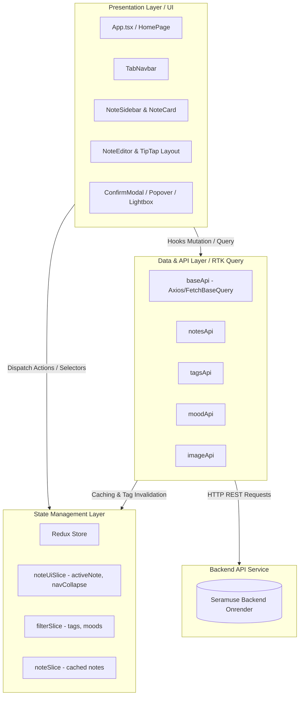

# 🌸 Seramuse Frontend (Seramuse_FE)

> **Seramuse** là ứng dụng ghi chép thông minh kết hợp theo dõi cảm xúc cá nhân (Mood-based Smart Note Taking Application), sở hữu giao diện Glassmorphism hiện đại, bộ công cụ soạn thảo phong phú (WYSIWYG TipTap Editor) cùng hệ thống phân loại ghi chú theo cảm xúc và nhãn dán trực quan.

---

## 📑 Mục lục

1. [Tổng quan dự án](#-tổng-quan-dự-án)
2. [Kiến trúc hệ thống (Architecture)](#-kiến-trúc-hệ-thống-architecture)
3. [Công nghệ sử dụng (Tech Stack)](#-công-nghệ-sử-dụng-tech-stack)
4. [Cấu trúc thư mục (Project Structure)](#-cấu-trúc-thư-mục-project-structure)
5. [Mô tả chi tiết các Modules & Chức năng](#-mô-tả-chi-tiết-các-modules--chức-năng)
   - [1. Quản lý ghi chú (Notes Management)](#1-quản-lý-ghi-chú-notes-management)
   - [2. Trình soạn thảo TipTap (Rich-text Editor)](#2-trình-soạn-thảo-tiptap-rich-text-editor)
   - [3. Quản lý Cảm xúc & Thẻ (Moods & Tags)](#3-quản-lý-cảm-xúc--thẻ-moods--tags)
   - [4. Tầng quản lý trạng thái & API (Redux & RTK Query)](#4-tầng-quản-lý-trạng-thái--api-redux--rtk-query)
   - [5. Giao diện & Trải nghiệm người dùng (UI / UX Layout)](#5-giao-diện--trải-nghiệm-người-dùng-ui--ux-layout)
6. [Quy trình luồng dữ liệu (Data Flow)](#-quy-trình-luồng-dữ-liệu-data-flow)
7. [Hướng dẫn cài đặt & Chạy dự án](#-hướng-dẫn-cài-đặt--chạy-dự-án)
8. [Quy chuẩn mã nguồn (Code Style & Linting)](#-quy-chuẩn-mã-nguồn-code-style--linting)

---

## 🌟 Tổng quan dự án

**Seramuse** mang đến trải nghiệm viết nhật ký / ghi chú nhẹ nhàng và thẩm mỹ. Ứng dụng giúp người dùng:

- Ghi lại suy nghĩ, công việc và ý tưởng nhanh chóng với trình soạn thảo văn bản hỗ trợ Markdown, Slash Command (`/`) và Bubble Menu.
- Gắn liền mỗi ghi chú với một **Cảm xúc (Mood)** và các **Thẻ nhãn (Tags)** với màu sắc sinh động.
- Tìm kiếm, lọc nâng cao theo cảm xúc, thẻ, và quản lý các ghi chú yêu thích (Favorites).
- Xem hình ảnh trực quan trong bài viết với tính năng phóng to toàn màn hình (Lightbox).

---

## 🏗 Kiến trúc hệ thống (Architecture)

Dự án được xây dựng theo mô hình **Component-Driven & Feature-Layered Architecture**, kết hợp chặt chẽ với kiến trúc dòng dữ liệu một chiều của **Redux Toolkit + RTK Query**.



### Các lớp kiến trúc chính:

1. **Presentation Layer (Lớp giao diện người dùng):**
   - Phân tách độc lập các Atomic Components (`common`), Khung xương chờ tải (`skeleton`), Bố cục chính (`layout`), và các tính năng nghiệp vụ (`notes`, `editor`, `dashboard`).
2. **State Management Layer (Lớp trạng thái ứng dụng):**
   - **Local UI State:** Điều hướng, trạng thái mở/đóng ghi chú, collapse navbar được gom vào `noteUiSlice`.
   - **Filter State:** Lưu trữ danh sách tag/mood đang được chọn để lọc toàn cục trong `filterSlice`.
3. **Data Access & Caching Layer (RTK Query):**
   - Sử dụng `baseApi` với cơ chế `injectEndpoints` giúp code phân tách rõ ràng theo domain (`notesApi`, `tagsApi`, `moodApi`, `imageApi`).
   - Tự động quản lý cache, đồng bộ dữ liệu và re-fetch thông minh qua cơ chế `tagTypes: ['NOTE', 'TAG', 'MOOD', 'UPLOADS']`.

---

## 🛠 Công nghệ sử dụng (Tech Stack)

| Hạng mục                | Công nghệ & Thư viện                                          | Mục đích sử dụng                                                             |
| :---------------------- | :------------------------------------------------------------ | :--------------------------------------------------------------------------- |
| **Core Framework**      | `React 19` + `TypeScript`                                     | Xây dựng giao diện ứng dụng với Type-safety                                  |
| **Build Tool**          | `Vite 8` + `@tailwindcss/vite`                                | Tốc độ khởi động siêu tốc, HMR và tối ưu hóa đóng gói build                  |
| **Styling & Icons**     | `Tailwind CSS v4`, `Lucide React`, `clsx`                     | Thiết kế Glassmorphism, pastel theme, quản lý icon tối giản                  |
| **Rich-text Editor**    | `@tiptap/react`, `@tiptap/starter-kit`, `@tiptap/extension-*` | Trình soạn thảo văn bản chuẩn ProseMirror, hỗ trợ Slash Command, Bubble Menu |
| **State & API**         | `@reduxjs/toolkit`, `react-redux`, `RTK Query`                | Quản lý state toàn cục, tự động caching & invalidation request               |
| **Media & Interaction** | `yet-another-react-lightbox`, `react-indiana-drag-scroll`     | Xem ảnh phóng to toàn màn hình, kéo cuộn danh sách tag mượt mà               |
| **Utilities**           | `moment`, `react-toastify`                                    | Xử lý thời gian tiếng Việt, hiển thị thông báo toast                         |
| **Code Quality**        | `ESLint 9`, `Prettier`, `Husky`, `lint-staged`                | Tự động format & kiểm tra lint trước khi commit code                         |

---

## 📂 Cấu trúc thư mục (Project Structure)

```
Seramuse_FE/
├── .husky/                 # Cấu hình Git hooks (pre-commit)
├── public/                 # Static assets công khai
├── src/
│   ├── assets/             # Hình ảnh, icons tĩnh của ứng dụng
│   ├── components/         # Các UI Components được phân chia theo module
│   │   ├── common/         # Các component dùng chung (Avatar, Dropdown, Modal, Tag, Pagination, EmptyState)
│   │   ├── dashboard/      # Các component phân tích, biểu đồ (DeepInsight, MainTrend, TopSummary)
│   │   ├── editor/         # Các menu điều khiển của TipTap (BubbleMenu, SlashCommandMenu, Toolbar)
│   │   ├── layout/         # Bố cục trang chính (NoteMainLayout, EditorLayout, HeaderLayout, DashboardLayout)
│   │   ├── navigation/     # Thanh điều hướng (TabNavbar)
│   │   ├── notes/          # Component nghiệp vụ ghi chú (NoteSidebar, NoteCard, NoteEditor, FilterPopover)
│   │   └── skeleton/       # Khung xương hiệu ứng loading (SidebarNoteSkeleton, EditorSkeleton)
│   ├── constants/          # Hằng số định nghĩa cấu hình (editor commands, active tabs)
│   ├── hooks/              # Custom React Hooks (useClickOutside, useDebounce, storeHooks)
│   ├── pages/              # Trang chính của ứng dụng (HomePage)
│   ├── services/           # RTK Query API Services (baseApi, notesApi, tagsApi, moodApi, imageApi)
│   ├── store/              # Redux Store cấu hình và các Slices (noteSlice, noteUiSlice, filterSlice)
│   ├── types/              # Định nghĩa kiểu dữ liệu TypeScript (Note, Mood, Tag, API Response)
│   ├── utils/              # Các hàm tiện ích (block parser, random color, date formatter, key down handlers)
│   ├── App.tsx             # Component gốc gắn Layout, Toast Container
│   ├── index.css           # Cấu hình Tailwind theme, Typography, ProseMirror TipTap styles
│   └── main.tsx            # Entry point render React DOM & Provider Redux
├── eslint.config.js        # Cấu hình ESLint v9
├── package.json            # Quản lý dependencies & scripts
├── tsconfig.json           # Cấu hình TypeScript
└── vite.config.ts          # Cấu hình Vite, Alias '@' và Code Splitting manual chunks
```

---

## 🧩 Mô tả chi tiết các Modules & Chức năng

### 1. Quản lý ghi chú (Notes Management)

- **Danh sách ghi chú (`NoteSidebar.tsx` & `NoteCard.tsx`):**
  - Hiển thị danh sách ghi chú dạng lưới (Grid) với bố cục tương thích đa màn hình.
  - Xem trước tiêu đề, nội dung tóm tắt dòng đầu tiên (`getFirstBlockText`), các thẻ tags đính kèm và ngày tạo được format theo chuẩn `DD/MM/YYYY`.
  - Phân trang dữ liệu thông minh (`Pagination.tsx`) với logic hiển thị dấu chấm rút gọn (`...`).
- **Tìm kiếm & Bộ lọc nâng cao (`FilterPopover.tsx`):**
  - Tìm kiếm ghi chú tức thời qua từ khóa (hỗ trợ nút clear nhanh).
  - Lọc đa điều kiện: Kết hợp nhiều **Tags** và nhiều **Moods** cùng lúc.
  - Hỗ trợ xem danh sách **Tất cả (All)** hoặc chỉ xem các ghi chú **Yêu thích (Favorites)**.
- **Tương tác nhanh:**
  - Nút thả tim yêu thích với cơ chế Debounce (`setTimeout` 500ms) chống spam request.
  - Nút xóa ghi chú kèm cảnh báo xác nhận an toàn qua `ConfirmModal.tsx`.
- **Trạng thái rỗng (`EmptyState.tsx`):**
  - Hiển thị giao diện thông báo trực quan tương ứng khi: Chưa có ghi chú nào, Không có kết quả tìm kiếm, hoặc Danh sách Favorites rỗng.

---

### 2. Trình soạn thảo TipTap (Rich-text Editor)

Nằm trong `NoteEditor.tsx` và `EditorLayout.tsx`, cung cấp giải pháp ghi chép hiện đại:

- **Định dạng văn bản toàn diện:**
  - Tiêu đề Heading 1, Heading 2, Heading 3.
  - In đậm (Bold), in nghiêng (Italic), gạch chân (Underline), gạch ngang (Strikethrough).
  - Đổi màu chữ tự do với bảng chọn màu (Color Picker).
  - Căn lề văn bản linh hoạt: Trái, Giữa, Phải, Căn đều (Justify).
  - Danh sách có thứ tự (Ordered List), danh sách dấu chấm (Bullet List), Khối trích dẫn (Blockquote), Khối mã nguồn (Code block).
- **Slash Command Menu (`/`):**
  - Khi gõ phím `/`, menu nổi bật lên cho phép người dùng chọn nhanh các khối định dạng hoặc chọn tải ảnh mà không cần rời tay khỏi bàn phím.
- **Formatting Bubble Menu & List Menu:**
  - Menu nổi thông minh tự động xuất hiện khi bôi đen đoạn văn bản để tùy biến kiểu dáng chữ nhanh.
- **Xử lý hình ảnh & Xem ảnh phóng to (Lightbox):**
  - Tích hợp chèn ảnh trực tiếp qua FileReader Base64 hoặc upload qua API.
  - Khi nhấp chuột vào bất kỳ bức ảnh nào trong văn bản, thư viện `yet-another-react-lightbox` sẽ mở ra trình xem ảnh phóng to toàn màn hình sắc nét.

---

### 3. Quản lý Cảm xúc & Thẻ (Moods & Tags)

- **Tâm trạng (Moods):**
  - Mỗi ghi chú được gắn với một trạng thái tâm trạng (vui vẻ, thư giãn, mệt mỏi, v.v.) thông qua `Dropdown.tsx`.
  - Dữ liệu tâm trạng hỗ trợ trọng số (`weight`) và icon minh họa.
- **Thẻ phân loại (Tags):**
  - Thêm thẻ với tính năng gợi ý thông minh (`TagInputWithDropdown.tsx`).
  - Hỗ trợ tạo mới thẻ với màu sắc hex ngẫu nhiên sinh động (`randomColor.util.ts`).
  - Xóa thẻ khỏi ghi chú hoặc xóa vĩnh viễn thẻ khỏi hệ thống.
  - Vùng hiển thị thẻ hỗ trợ thao tác kéo chuột ngang mượt mà (`react-indiana-drag-scroll`).

---

### 4. Tầng quản lý trạng thái & API (Redux & RTK Query)

| Service / Slice      | Trách nhiệm chính                                                                                             | Endpoints / Actions                                                               |
| :------------------- | :------------------------------------------------------------------------------------------------------------ | :-------------------------------------------------------------------------------- |
| **`baseApi.ts`**     | Khởi tạo cấu hình gốc RTK Query, gắn `Authorization: Bearer <token>` từ LocalStorage, quản lý các `tagTypes`. | -                                                                                 |
| **`notesApi.ts`**    | Tương tác API Ghi chú                                                                                         | `getNotes`, `getNote`, `createNote`, `updateNote`, `deleteNote`, `updateFavorite` |
| **`tagsApi.ts`**     | Tương tác API Thẻ                                                                                             | `getTags`, `getTag`, `createTag`, `deleteTag`                                     |
| **`moodApi.ts`**     | Tương tác API Tâm trạng                                                                                       | `getMoods`                                                                        |
| **`imageApi.ts`**    | Tương tác API Tải ảnh                                                                                         | `uploadImage`, `uploadImages`, `getUpload`, `getUploads`                          |
| **`noteUiSlice.ts`** | Quản lý trạng thái giao diện                                                                                  | `selectNote(id)`, `closeNote()`, `toggleNav()`                                    |
| **`filterSlice.ts`** | Quản lý dữ liệu bộ lọc                                                                                        | `setTags(tags)`, `setMoods(moods)`                                                |
| **`noteSlice.ts`**   | Quản lý danh sách ghi chú cục bộ                                                                              | `setNotes(notes)`                                                                 |

---

### 5. Giao diện & Trải nghiệm người dùng (UI / UX Layout)

- **Chế độ hiển thị thông minh (`NoteMainLayout.tsx`):**
  - Khi chưa chọn ghi chú: Hiển thị danh sách thẻ ghi chú (`NoteSidebar`).
  - Khi bấm vào một ghi chú hoặc tạo mới: Mở ngay khung soạn thảo toàn màn hình (`NoteEditor`).
- **Sidebar điều hướng có thể thu gọn (`TabNavbar.tsx`):**
  - Nút bấm `PanelLeftClose` / `PanelLeftOpen` cho phép ẩn/hiện thanh điều hướng linh hoạt để tối đa hóa không gian viết.
- **Skeleton Loading (`EditorSkeleton.tsx`, `SidebarNoteSkeleton.tsx`):**
  - Hiệu ứng chuyển động pulse nhẹ nhàng trong quá trình chờ API phản hồi, hạn chế tối đa cảm giác giật lag giao diện.

---

## 🔄 Quy trình luồng dữ liệu (Data Flow)

1. **Khởi tạo ứng dụng:**
   - Ứng dụng load danh sách ghi chú, danh sách Tags và Moods ban đầu thông qua các RTK Query Hooks (`useGetNotesQuery`, `useGetTagsQuery`, `useGetMoodsQuery`).
2. **Tạo / Mở ghi chú:**
   - Người dùng nhấp "Tạo ghi chú mới" hoặc bấm vào 1 thẻ ghi chú -> Redux cập nhật `activeNoteId` qua action `selectNote(id)`.
   - `NoteMainLayout` chuyển sang render `NoteEditor`. `useGetNoteQuery` lấy chi tiết dữ liệu khối (`blocks`) để nạp vào TipTap Editor.
3. **Chỉnh sửa & Lưu:**
   - Khi người dùng sửa tiêu đề, chọn Mood, thêm/bớt Tag hoặc gõ nội dung -> state nội bộ cập nhật.
   - Khi nhấn **Save**, `useUpdateNoteMutation` được gọi -> Backend cập nhật thành công -> RTK Query tự động `invalidatesTags: ['NOTE']` -> Danh sách ghi chú ở Sidebar tự động đồng bộ lại nội dung mới nhất.

---

## 🚀 Hướng dẫn cài đặt & Chạy dự án

### 1. Yêu cầu môi trường

- **Node.js:** `>= 18.x` (Khuyến nghị sử dụng bản LTS mới nhất)
- **Trình quản lý gói:** `npm` hoặc `yarn` / `pnpm`

### 2. Cài đặt các gói phụ thuộc

```bash
# Clone repository (nếu chưa clone)
git clone <repository-url>
cd Seramuse_FE

# Cài đặt dependencies
npm install
```

### 3. Cấu hình biến môi trường

Tạo file `.env` tại thư mục gốc (tham khảo `.env.example`):

```env
# URL API Backend (Mặc định cấu hình trong baseApi.ts trỏ đến https://seramuse-be.onrender.com)
VITE_API_URL=https://seramuse-be.onrender.com
```

### 4. Khởi chạy môi trường phát triển (Dev Mode)

```bash
npm run dev
```

Ứng dụng sẽ chạy tại địa chỉ: `http://localhost:5173`

### 5. Đóng gói ứng dụng (Production Build)

```bash
# Kiểm tra Type và đóng gói bản build
npm run build

# Xem trước bản build production
npm run preview
```

---

## 🎨 Quy chuẩn mã nguồn (Code Style & Linting)

Dự án tích hợp sẵn các công cụ tự động kiểm tra cú pháp và định dạng code:

```bash
# Chạy kiểm tra và tự động sửa lỗi ESLint
npm run lint

# Tự động định dạng lại toàn bộ code bằng Prettier
npm run format
```

> **Git Hooks:** Dự án sử dụng `Husky` và `lint-staged` để tự động chạy linter và format trên các file được staged trước mỗi lần `git commit`.

---

<p align="center">
  Được phát triển với tình yêu và sự tỉ mỉ dành cho trải nghiệm viết lách 🌸
</p>
